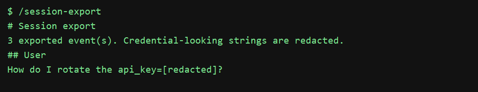

# dsh-plugin-session-archive

**Export the current DSH session as a clean, redacted Markdown transcript with one command.**

Sessions live in a local log. This plugin turns the current one into something you can paste into an issue, archive, or share — with credential-looking strings removed. It is read-only: no network calls, no file writes, no prompt upload.

## Install

```powershell
dsh plugin --profile web add dsh-plugin-session-archive
```

Requires Node `^22.19.0 || >=24` and DSH `>=0.2.0-rc.2 <0.3.0`.

## 30-second demo

```text
/session-export
```

```markdown
# Session export

3 exported event(s). Credential-looking strings are redacted.

# Turn 1

## User

How do I rotate the api_key=[redacted]?

## Assistant

Use the console and revoke the old one.

### Tool call: bash

$ echo token=[redacted]
```

`/session-export json` returns JSON rows; `/session-export --max-kb=64` caps the output.

## Configuration

No configuration is required. The bundle patch only inserts the plugin row:

```yaml
- id: dsh-plugin-session-archive
  name: dsh-plugin-session-archive
```

| Flag | Default | Meaning |
|---|---|---|
| `json` | off | Emit JSON rows instead of Markdown. |
| `--max-kb=N` | `128` | Cap output size (clamped to 1–512 KB). |

## What is exported

| Event | Rendered |
|---|---|
| `turn/start` | Turn heading |
| `user/message` | User text (and skill name when applicable) |
| `assistant/message` | Assistant text, with the last observed provider/model |
| `tool/call` | Tool name plus `command`, `path`, or `query` only |
| `tool/result` | Text blocks of `tool-result` and error text |
| everything else | ignored |

Unknown fields are never serialized. Credential-looking strings are redacted in every emitted field.

## Privacy & safety

- Only allowlisted text fields are read. No arbitrary event data is copied.
- No network calls, no telemetry, no file writes. Output goes to the command response only.
- Redaction runs on every emitted string before rendering.
- If you need a different redaction rule, edit `src/core.ts` locally — do not disable it.

## Compatibility

| Component | Supported |
|---|---|
| DSH | `>=0.2.0-rc.2 <0.3.0` |
| Node | `^22.19.0 \|\| >=24.0.0` |
| Cordis | `>=4.0.0 <5` |
| Surface | headless and web (command registry only) |

## Troubleshooting

| Symptom | Cause | Fix |
|---|---|---|
| `/session-export` not found | Bundle row not installed | Re-run `dsh plugin --profile web add dsh-plugin-session-archive`, restart DSH. |
| Export is truncated | `--max-kb` cap reached | Raise it up to 512. |
| Tool arguments look empty | Only `command`/`path`/`query` are rendered by design | This is intentional to avoid leaking arbitrary data. |
| No route shown on assistant messages | No `request/*` event yet in the session | Use the session once more, then export. |

## Development

```powershell
npm install
npm test
npm pack --dry-run
```

Tests are fully offline with synthetic event fixtures.

## License

[MIT](LICENSE)


## Demo




## Listed in

- [awesome-ai-plugins — DeepSeek Harness Plugins](https://github.com/hashgraph-online/awesome-ai-plugins#deepseek-harness-plugins) (security scan passed).

## Related plugins

- [dsh-plugin-safe-route](https://github.com/SSHOOTING/dsh-plugin-safe-route)
- [dsh-plugin-token-budget](https://github.com/SSHOOTING/dsh-plugin-token-budget)
- [dsh-plugin-mcp-guard](https://github.com/SSHOOTING/dsh-plugin-mcp-guard)
- [dsh-plugin-free-model-advisor](https://github.com/SSHOOTING/dsh-plugin-free-model-advisor)
